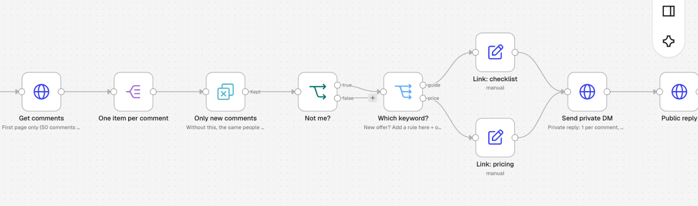

# Instagram Comment → DM (n8n template)

Someone comments your keyword on a reel → in under a minute they get a private DM with your link, a public reply under their comment, and a new row in your Google Sheet.

📺 Video walkthrough: [Instagram Comment to DM Automation with n8n](https://www.youtube.com/@workflowkitchen)

## What's inside

| Node | Job |
|---|---|
| Every minute | Checks the post once a minute (switch to every 20 min when you go live on n8n Cloud Starter) |
| Config | Your 4 settings: API version, reel ID, your username, public reply text |
| Get comments → One item per comment | Reads the comments on your reel, one item per comment |
| Only new comments | Remove Duplicates on the comment ID, so nobody gets the same DM twice |
| Not me? | Skips your own comments |
| Which keyword? | Switch node: `guide` → checklist link, `price` → pricing link. One rule = one offer |
| Link: checklist / Link: pricing | The link each keyword sends |
| Send private DM | Private reply via `recipient.comment_id` |
| Public reply | "Sent! Check your DMs (or Requests if you don't follow me yet)" |
| Lead row → Log lead | Appends Username, Comment, Time, Post, Comment ID to Google Sheets |
| Run once: list my posts | Manual helper to find your reel ID |

## Setup (about 20 minutes)

**You need:** a public Instagram professional account (Creator or Business), n8n (Cloud or self-hosted), a Google Sheet with a tab `Leads` and the header row `Username | Comment | Time | Post | Comment ID`, and a second Instagram account for testing.

1. **Token.** [developers.facebook.com/apps](https://developers.facebook.com/apps) → Create app → use case *Manage messaging & content on Instagram* → *API setup with Instagram login* → add your account → Generate token. Permissions: `instagram_business_basic`, `instagram_business_manage_comments`, `instagram_business_manage_messages`.
2. **Import.** n8n → Workflows → Import from file → `workflow.json`.
3. **Credential.** Credentials → Add → *Header Auth*. Name: `Authorization`. Value: `Bearer YOUR_TOKEN` (the word Bearer, a space, the token). Select it in the 4 HTTP nodes: List my posts, Get comments, Send private DM, Public reply.
4. **Google Sheets.** Connect your Google account in *Log lead* and pick your sheet.
5. **Reel ID.** Run the bottom branch *Run once: list my posts*, find your reel by caption, copy its `id` into **Config → MEDIA_ID**. Set **MY_USERNAME** (without @).
6. **Links and keywords.** Replace `example.com` in the green *Link:* nodes. Keywords live in *Which keyword?*.
7. **Test** with a comment from your second account, then switch the workflow to Active.

## Rules Meta enforces

- One private reply per comment, within 7 days of the comment.
- If the person doesn't follow you, the DM lands in their **message requests**.
- If they reply, you have a 24-hour window to keep talking.
- Message text: 1,000 bytes max.

## Not working?

| Symptom | Fix |
|---|---|
| Error 190 / OAuthException | Token expired (they last 60 days) or `Bearer ` is missing. Refresh: `GET https://graph.instagram.com/refresh_access_token?grant_type=ig_refresh_token&access_token=YOUR_TOKEN` |
| "Cannot parse access token" | Use `graph.instagram.com`, not `graph.facebook.com`, with an Instagram Login token |
| "Forbidden" on the DM | The first DM must go to `recipient.comment_id`, never a user ID |
| `data: []` from Get comments | Wrong media ID or the account is private |
| DM never arrived | Check message requests; comments older than 7 days can't get a private reply |
| DM only reaches you and your testers | Your Meta app needs Advanced Access for `instagram_business_manage_messages` (App Review) |
| Google Sheets node fails after edits | Don't rename sheet columns after setting up the node |

## Going live on n8n Cloud

Every minute ≈ 43,200 runs a month; the Starter plan includes 2,500. Every 20 minutes ≈ 2,160 runs, so you stay inside the plan.

---

Free to use and modify. No email needed. Made by [Workflow Kitchen](https://www.youtube.com/@workflowkitchen).
